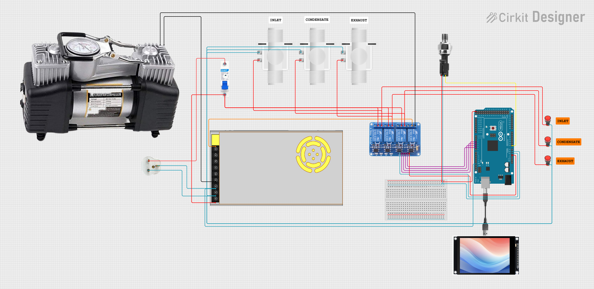

# Sterilizer Hub - IoT Autoclave Monitoring & Control System

[](https://www.python.org/)
[](https://flask.palletsprojects.com/)
[](https://socket.io/)
[](https://www.mysql.com/)
[](https://www.arduino.cc/)
[]()
[](LICENSE)

**Sterilizer Hub** adalah sistem Supervisory Control and Data Acquisition (SCADA) dan Human-Machine Interface (HMI) berbasis web untuk pemantauan dan pengendalian mesin sterilisasi (autoclave) bertekanan tinggi secara *real-time*. 

Sistem ini memadukan mikrokontroler Arduino/ESP32, sensor tekanan barometrik terkalibrasi, aktuator relay katup 4-kanal, dan antarmuka web modern dengan visualisasi data langsung, sistem proteksi *overpressure*, serta ekspor log aktivitas terenkripsi.

---

## Daftar Isi
1. [Arsitektur Sistem](#arsitektur-sistem)
2. [Fitur Unggulan](#fitur-unggulan)
3. [Skematik Rangkaian Hardware](#skematik-rangkaian-hardware)
4. [Keamanan Sistem (OWASP Hardened)](#keamanan-sistem-owasp-hardened)
5. [Prasyarat Sistem](#prasyarat-sistem)
6. [Panduan Download & Kloning](#panduan-download--kloning)
7. [Panduan Instalasi Langkah Demi Langkah](#panduan-instalasi-langkah-demi-langkah)
8. [Panduan Menjalankan Aplikasi](#panduan-menjalankan-aplikasi)
9. [Flashing Firmware Arduino](#flashing-firmware-arduino)
10. [Konfigurasi Lingkungan (.env)](#konfigurasi-lingkungan-env)
11. [Kredensial Login Default](#kredensial-login-default)
12. [Pemecahan Masalah (Troubleshooting)](#pemecahan-masalah-troubleshooting)
13. [Struktur Direktori Proyek](#struktur-direktori-proyek)
14. [Lisensi & Pengembang](#lisensi--pengembang)

---

## Arsitektur Sistem

```
+-------------------------------------------------------------+
|                     Client Web Browser                      |
|      (HTML5 / Bootstrap 5 / Chart.js / Socket.IO Client)     |
+------------------------------+------------------------------+
                               |
                   HTTP(S) / WebSocket (WSS)
                               |
+------------------------------v------------------------------+
|                    Flask Backend Server                     |
|  - Rate Limiter (Anti Brute-Force Bertingkat)               |
|  - Security Headers Middleware (nosniff, SAMEORIGIN, XSS)   |
|  - Session Auth & Role-Based Access (Admin / Operator)      |
|  - Authenticated WebSocket Control Events                   |
+---------------+------------------------------+--------------+
                |                              |
         SQL (Parameterized)             Serial Protocol
        (Context Manager Pool)          (115200 Baud, COM10)
                |                              |
+---------------v--------------+  +------------v--------------+
|        MySQL Database        |  |   Arduino / Microcontroller|
|  - Password Hashing (scrypt) |  |  - Median Filter Sensor A0|
|  - Auto Table Migration      |  |  - 4-Relay Actuator Logic |
|  - Process & Alert Logs      |  |  - Auto Step Sequences    |
+------------------------------+  +---------------------------+
```

---

## Fitur Unggulan

- **Real-Time Pressure Streaming**: Pembaruan data tekanan barometrik setiap 500 ms via WebSocket tanpa reload halaman.
- **Dynamic Chart Trend**: Grafik interaktif 270 detik riwayat tekanan menggunakan Chart.js dengan tema responsif.
- **Dual Mode Operation**: Otomatis mendeteksi port hardware serial (`COM10`). Jika perangkat keras tidak terhubung, sistem otomatis masuk ke **SIMULATION MODE** sehingga pengembangan dan demo tetap dapat dijalankan tanpa error.
- **Auto-Logging Process**: Pencatatan riwayat tekanan, status langkah, dan peringatan bahaya ke database MySQL secara otomatis setiap 5 detik saat proses sterilisasi aktif.
- **Export Data Log (CSV)**: Unduh data log langsung dari browser dalam format `.csv` untuk keperluan audit dan kepatuhan laboratorium.
- **Dark & Light Interface**: Mode tampilan gelap dan terang yang nyaman di mata operator.
- **Role-Based Access Control (RBAC)**: Pemisahan peran antara **Administrator** (akses penuh & audit) dan **Operator** (kontrol proses harian).

---

## Skematik Rangkaian Hardware

Berikut adalah diagram perkabelan mikrokontroler Arduino dengan sensor tekanan dan modul relay katup:



### Pinout Hardware Arduino:
| Komponen | Pin Arduino | Deskripsi Fungsi |
|---|---|---|
| **K1 (Relay 1)** | `Digital Pin 3` | Solenoid Valve Inlet (Pengisian uap panas) |
| **K2 (Relay 2)** | `Digital Pin 4` | Solenoid Valve Exhaust (Pembuangan uap) |
| **K3 (Relay 3)** | `Digital Pin 5` | Solenoid Valve Condensate (Pembuangan air kondensat) |
| **K4 (Relay 4)** | `Digital Pin 6` | Water Pump / Steam Generator Booster |
| **Pressure Sensor** | `Analog Pin A0` | Sensor Tekanan Barometrik (Filtered ADC) |

> Dokumentasi kalkulasi kompensasi tegangan sensor dan perhitungan sirkuit lengkap tersedia pada file: [sterilizer_hub.pdf](docs/sterilizer_hub.pdf).

---

## Keamanan Sistem (OWASP Hardened)

Sistem telah diuji dan diperkeras sesuai standar keamanan industri OWASP Top 10 dan CWE Top 25:
1. **Password Hashing (CWE-256 / OWASP A02:2021)**: Menggunakan algoritma kriptografis modern **`scrypt`** via `werkzeug.security`. Password tidak pernah disimpan dalam format teks polos (*plaintext*).
2. **Authenticated WebSocket Control (CWE-285 / OWASP A01:2021)**: Pengiriman perintah start/stop/reset wajib melalui sesi web terautentikasi dan divalidasi dengan daftar perintah yang diizinkan (*command whitelist*).
3. **Server-Side Anti Brute-Force (CWE-307 / OWASP A07:2021)**: Proteksi percobaan login bertingkat (lockout 30s / 60s / 120s) yang diatur di sisi server dengan kode status HTTP 429 (*Too Many Requests*).
4. **Environment-Based Config (CWE-798)**: Kredensial database, port serial, dan kunci rahasia aplikasi dikonfigurasi melalui file `.env`.
5. **Security Headers (OWASP A05:2021)**: Penerapan header keamanan HTTP (`X-Content-Type-Options: nosniff`, `X-Frame-Options: SAMEORIGIN`, `X-XSS-Protection`) serta proteksi cookie sesi `HttpOnly` & `SameSite=Lax`.
6. **Leak-Proof Database Connections (CWE-775)**: Penggunaan Python Context Manager (`with get_db()`) menjamin pembebasan koneksi pool secara otomatis.

---

## Prasyarat Sistem

Sebelum menginstal Sterilizer Hub, pastikan komputer Anda telah terpasang:
- **Sistem Operasi**: Windows 10/11, Linux (Ubuntu/Debian), atau macOS.
- **Python**: Versi 3.10, 3.11, 3.12, atau 3.13. (Pastikan mencentang *"Add Python to PATH"* saat instalasi).
- **Database**: XAMPP (Apache + MySQL/MariaDB) atau server MySQL mandiri aktif di port `3306`.
- **Git**: Untuk kloning repositori (opsional jika mengunduh berkas ZIP).
- **Arduino IDE**: Versi 2.x (jika ingin mengompilasi dan mengunggah kode ke papan mikrokontroler fisik).

---

## Panduan Download & Kloning

### Opsi 1: Menggunakan Git CLI (Direkomendasikan)
Buka terminal (Command Prompt, PowerShell, atau Git Bash), lalu jalankan:
```bash
git clone https://github.com/aidilham21/sterilizer_hub.git
cd sterilizer_hub
```

### Opsi 2: Download Arsip ZIP Langsung
1. Buka repositori: [https://github.com/aidilham21/sterilizer_hub](https://github.com/aidilham21/sterilizer_hub)
2. Klik tombol hijau **`Code`** lalu pilih **`Download ZIP`**.
3. Ekstrak berkas zip tersebut ke folder pilihan Anda (misalnya `C:\Projects\sterilizer_hub`).
4. Buka terminal pada folder hasil ekstraksi tersebut.

---

## Panduan Instalasi Langkah Demi Langkah

### Langkah 1: Buat Virtual Environment (Sangat Disarankan)
Membuat lingkungan virtual Python menjaga dependensi proyek tetap terisolasi:

**Di Windows:**
```cmd
python -m venv venv
venv\Scripts\activate
```

**Di Linux / macOS:**
```bash
python3 -m venv venv
source venv/bin/activate
```

### Langkah 2: Pasang Paket Dependensi
Jalankan perintah berikut untuk menginstal semua pustaka yang dibutuhkan:
```bash
pip install -r requirements.txt
```

### Langkah 3: Konfigurasi File Lingkungan (.env)
Salin template konfigurasi `.env.example` menjadi `.env`:

**Di Windows:**
```cmd
copy .env.example .env
```

**Di Linux / macOS:**
```bash
cp .env.example .env
```

Buka file `.env` dengan text editor pilihan Anda. Jika Anda menggunakan instalasi XAMPP standar, konfigurasi default sudah langsung cocok:
- Database Host: `localhost`
- Database User: `root`
- Database Password: *(kosong)*
- Database Name: `sterilizer_db` (database dan tabel akan dibuat secara otomatis oleh sistem saat pertama kali dijalankan).

### Langkah 4: Pastikan Layanan MySQL Berjalan
- Buka **XAMPP Control Panel**.
- Klik tombol **Start** pada modul **MySQL**.
- Pastikan modul MySQL menyala hijau dengan port `3306`.

---

## Panduan Menjalankan Aplikasi

### Cara 1: Menggunakan 1-Click Launcher (Windows)
Cukup klik ganda (double-click) file:
```cmd
run.bat
```
Script otomatis ini akan:
1. Memverifikasi instalasi Python.
2. Memeriksa ketersediaan layanan MySQL di port 3306 (dan menyalakan mysqld secara otomatis jika XAMPP terpasang di `C:\xampp`).
3. Membuka peramban default ke alamat `http://localhost:5000`.
4. Menjalankan server aplikasi Flask & WebSocket.

### Cara 2: Menjalankan Secara Manual via Terminal
Jalankan perintah:
```bash
python app.py
```
Akses aplikasi melalui peramban:
- **Lokal**: [http://localhost:5000](http://localhost:5000) atau [http://127.0.0.1:5000](http://127.0.0.1:5000)
- **Jaringan Lokal (LAN)**: `http://[IP-KOMPUTER-ANDA]:5000`

---

## Flashing Firmware Arduino

Jika Anda menghubungkan perangkat keras fisik:
1. Buka software **Arduino IDE**.
2. Pilih menu **File > Open**, lalu buka berkas:
   ```
   docs/sterilizer_hub.ino
   ```
3. Hubungkan board Arduino Uno / Nano / Mega ke komputer menggunakan kabel USB.
4. Pilih board yang sesuai pada menu **Tools > Board**.
5. Pilih port serial yang terdeteksi pada menu **Tools > Port** (misal `COM10`).
6. Klik tombol **Upload** (ikon panah ke kanan).
7. Jika nomor port yang terdeteksi berbeda dari `COM10` (misal `COM3`), sesuaikan nilai `SERIAL_PORT` di dalam file `.env`:
   ```ini
   SERIAL_PORT=COM3
   ```

---

## Konfigurasi Lingkungan (.env)

Seluruh parameter sistem dapat dikustomisasi melalui berkas `.env`:

| Variabel | Nilai Default | Keterangan |
|---|---|---|
| `SECRET_KEY` | *(Random 64-char Hex)* | Kunci kriptografis sesi Flask. |
| `FLASK_DEBUG` | `False` | Mode debug pengembang (`True`/`False`). |
| `APP_HOST` | `0.0.0.0` | IP bind server (`0.0.0.0` untuk akses LAN). |
| `APP_PORT` | `5000` | Port HTTP web server. |
| `DB_HOST` | `localhost` | Host database MySQL. |
| `DB_PORT` | `3306` | Port database MySQL. |
| `DB_USER` | `root` | Username MySQL. |
| `DB_PASSWORD` | *(kosong)* | Password MySQL. |
| `DB_NAME` | `sterilizer_db` | Nama basis data sistem. |
| `DEFAULT_ADMIN_USER` | `admin` | Username default Administrator. |
| `DEFAULT_ADMIN_PASSWORD` | `admin123` | Password default Administrator. |
| `DEFAULT_OPERATOR_USER` | `idil` | Username default Operator. |
| `DEFAULT_OPERATOR_PASSWORD` | `idil123` | Password default Operator. |
| `SERIAL_PORT` | `COM10` | Port komunikasi serial Arduino. |
| `SERIAL_BAUDRATE` | `115200` | Kecepatan baud komunikasi serial. |
| `SERIAL_TIMEOUT` | `1.0` | Waktu jeda timeout pembacaan serial (detik). |

---

## Kredensial Login Default

| Role | Username | Password | Hak Akses |
|---|---|---|---|
| **Administrator** | `admin` | `admin123` | Akses penuh antarmuka HMI, monitoring, kontrol proses, unduh log aktivitas. |
| **Operator** | `idil` | `idil123` | Monitoring tekanan langsung, kontrol start/stop/reset proses sterilisasi. |

> **PENTING**: Untuk keamanan produksi, ubah username dan password default pada file `.env` sebelum menghubungkan sistem ke jaringan terbuka.

---

## Pemecahan Masalah (Troubleshooting)

### 1. Database Error: Can't connect to MySQL server on 'localhost:3306' (10061)
- **Penyebab**: Layanan MySQL / MariaDB belum aktif.
- **Solusi**: Buka XAMPP Control Panel dan klik tombol **Start** pada modul MySQL. Jika menggunakan script `run.bat`, script akan mencoba mengaktifkan layanan ini secara otomatis.

### 2. Status Menampilkan `SIMULATION MODE`
- **Penyebab**: Board Arduino tidak terdeteksi pada port yang ditentukan (default `COM10`).
- **Solusi**: 
  - Pastikan kabel USB Arduino terhubung kuat.
  - Periksa port COM yang terdeteksi melalui **Device Manager** di Windows.
  - Ubah nilai `SERIAL_PORT` pada file `.env` sesuai port yang terdeteksi (contoh: `SERIAL_PORT=COM4`).
  - Catatan: Sistem tetap dapat digunakan secara penuh dalam mode simulasi meskipun tanpa hardware fisik.

### 3. RuntimeError: The Werkzeug web server is not designed to run in production
- **Penyebab**: Flask-SocketIO mendeteksi server pengembang Werkzeug.
- **Solusi**: Sudah ditangani secara otomatis pada [app.py](app.py) dengan parameter `allow_unsafe_werkzeug=True`.

---

## Struktur Direktori Proyek

```
sterilizer_hub/
├── config.py                 # Konfigurasi terpusat (ENV, DB, Serial, Security)
├── .env                      # File konfigurasi aktif lokal
├── .env.example              # Template variabel lingkungan
├── app.py                    # Server Flask + Socket.IO (Authenticated & Hardened)
├── database.py               # Layer Database (Hashed password, connection manager)
├── requirements.txt          # Daftar dependensi resmi
├── .gitignore                # Filter file cache, bytecode, dan rahasia
├── LICENSE                   # Lisensi open-source MIT
├── README.md                 # Dokumentasi lengkap proyek
├── run.bat                   # Launcher otomatis 1-klik (Cek MySQL + App + Browser)
├── push.bat                  # Git push helper
├── pull.bat                  # Git pull helper
├── docs/                     # Dokumentasi & Firmware Arduino
│   ├── sterilizer_hub.ino    # Sketch sensor & relay sterilizer
│   ├── sterilizer_hub.pdf    # Dokumentasi kalkulasi kompensasi & sirkuit
│   ├── sterilizer_hub_schema.png # Gambar skematik rangkaian hardware
│   └── .theia/launch.json    # Konfigurasi workspace Arduino IDE
├── static/                   # Aset statis antarmuka web
│   ├── backgroundlogin.png
│   └── logo.png
└── templates/                # Template Jinja2
    ├── index.html            # HMI Dashboard & Real-Time Chart
    └── login.html            # Antarmuka login dengan status lockout server
```

---

## Lisensi & Pengembang

Proyek ini dilisensikan di bawah lisensi terbuka [MIT License](LICENSE).

Dikembangkan oleh **Group 1**:
- **Muh. Aidil Ilham** (Lead Developer)
- **Aldi Rahmat**
- **Janevirah Fauzi**
- **Fitra Ramadhani**
- **Novika Pitriani Nasution**

&copy; 2026 Sterilizer Hub Project. All Rights Reserved.
